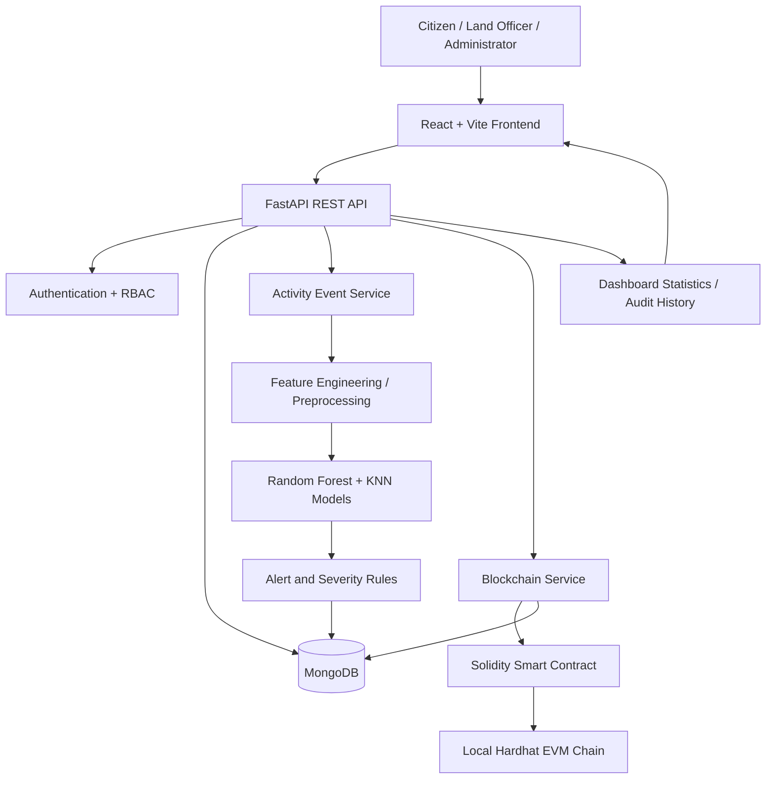

# LandSecure AI — System Architecture

## 1. Project overview
**Project title:** Intelligent Cyber Threat Prediction Model for Blockchain-Enabled Land Revenue Records

LandSecure AI is an educational prototype for managing synthetic land records, detecting suspicious activity with machine learning, and verifying record integrity using blockchain-backed hashes.

The project proposal specifies Random Forest, K-Nearest Neighbors (KNN), blockchain, activity monitoring, and administrator alerts. This architecture turns those concepts into an implementable web application.

## 2. High-level architecture



## 3. Main components

### Frontend
- React with Vite, React Router, Axios, Tailwind CSS, and Recharts.
- Login, role-specific dashboards, land-record CRUD, threat monitoring, alerts, audit history, and blockchain verification.
- Uses backend APIs; no sensitive authorization logic is trusted to the frontend alone.

### Backend API
- FastAPI with Pydantic request/response schemas.
- Authentication, role-based authorization, land-record workflows, event ingestion, ML prediction, alert management, and blockchain integration.
- OpenAPI documentation at `/docs` during development.

### Database
MongoDB stores:
- Users and roles.
- Land records and versions.
- Activity events.
- Threat predictions.
- Alerts and investigation status.
- Blockchain transaction references and reconciliation status.

### Machine-learning service
- Random Forest classifier for labeled suspicious-activity classification.
- KNN classifier or a clearly documented KNN-based anomaly baseline.
- Preprocessing pipeline and model artifacts saved with joblib.
- Metrics: precision, recall, F1-score, confusion matrix, accuracy, and ROC-AUC when appropriate.
- Training and test split must avoid data leakage. Use synthetic data only when clearly labeled.

### Blockchain service
- Solidity contract deployed to a local Hardhat chain for demonstration.
- Stores record identifiers, hashes, version information, and relevant audit events—not full private land records.
- Backend computes a deterministic canonical representation and hash of each record.
- A verification endpoint compares the current record hash against the registered on-chain hash.

### Alerts and monitoring
- Activity events are scored by the ML pipeline and configurable deterministic rules.
- Alerts use LOW, MEDIUM, HIGH, and CRITICAL severity.
- Admin can review, investigate, and resolve alerts.
- Simulated events must be labeled as simulated.

## 4. Key workflows

### Create or update a record
1. Authenticate the user and check role permissions.
2. Validate the requested change.
3. Save a versioned record and audit event in MongoDB.
4. Canonicalize the record and compute its hash.
5. Submit the hash to the smart contract.
6. Store transaction reference and status.
7. Show confirmed, pending, or failed status in the UI.
8. Reconcile pending/failed blockchain submissions instead of claiming success prematurely.

### Detect suspicious activity
1. Receive and validate activity event.
2. Store the event and derive model features.
3. Run preprocessing and ML inference.
4. Apply configurable thresholds and deterministic rules.
5. Store prediction and create an alert when criteria are met.
6. Display the event in the admin dashboard.

### Verify record integrity
1. Retrieve the current stored record.
2. Recompute its canonical hash.
3. Read the expected hash/version from the smart contract.
4. Compare values.
5. Return `VERIFIED` or `INTEGRITY_MISMATCH`, with an audit event for mismatches.

## 5. Trust and security boundaries
- Browser → API: HTTPS in production; local HTTP only for development.
- API → MongoDB: credentials from environment variables and least-privilege database access.
- API → blockchain: local development signer for demo only; never commit private keys.
- ML output is a risk signal, not proof of malicious intent.
- A mismatch is evidence of integrity failure, not proof of a particular attacker.
- Database and blockchain writes are not atomic together. Use explicit `PENDING`, `CONFIRMED`, and `FAILED` states with retry/reconciliation.

## 6. Suggested repository layout

```text
landsecure-ai/
├── frontend/
│   ├── src/
│   │   ├── components/
│   │   ├── layouts/
│   │   ├── pages/
│   │   ├── services/
│   │   ├── hooks/
│   │   └── charts/
│   ├── package.json
│   └── .env.example
├── backend/
│   ├── app/
│   │   ├── core/
│   │   ├── routers/
│   │   ├── schemas/
│   │   ├── services/
│   │   ├── database/
│   │   ├── ml/
│   │   ├── blockchain/
│   │   └── main.py
│   ├── tests/
│   └── requirements.txt
├── ml/
│   ├── data/
│   ├── scripts/
│   ├── models/
│   └── reports/
├── blockchain/
│   ├── contracts/
│   ├── scripts/
│   ├── test/
│   └── hardhat.config.js
├── postman/
├── docs/
├── README.md
└── .gitignore
```

## 7. Architecture decisions
- Use MongoDB for application records and history; use blockchain only for integrity proofs and audit metadata.
- Use FastAPI as the single application API to reduce integration complexity.
- Train models in a reproducible script; do not train on every API request.
- Keep ML predictions explainable enough for a college demonstration.
- Start with a local Hardhat chain; production deployment is out of scope.
- Use seeded synthetic data and repeatable demo scenarios.
